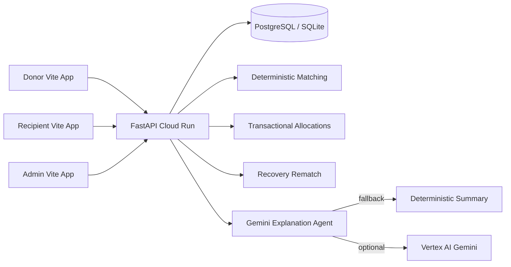

# Architecture — RescueFlow AI by FoodBridge

## System overview

## Request flows

1. **Create donation** → validate deadline/quantity → persist `Donation` → `create_invitations` ranks eligible recipients → audit event.
2. **Decline invitation** → mark declined (no stock change) → rematch remaining stock → audit.
3. **Accept invitation** → row locks (Postgres) → allocate `min(suggested, remaining, capacity)` → update donation status → cancel pending only if remaining=0, else rebalance offers → allocation with `pickup_status=pending`.
4. **Confirm pickup** → separate state transition on allocation; does not change donation ledger.

## State machines

### Donation
`open` → `partially_allocated` → `allocated`  
also: `expired`, `cancelled`

### Invitation
`pending` → `accepted` | `declined` | `cancelled` | `expired`

### Pickup (on Allocation)
`pending` → `confirmed` → `completed` (or `failed`)

## Matching & recovery

Hard filters before scoring: donation open/partial, remaining > 0, recipient active, category compatible, earliest pickup within deadline, not previously accepted/declined/cancelled (no auto re-invite).

Score weights (configurable): deadline 35%, capacity 30%, distance 20%, preference 15%. Distance is **synthetic demo data**, not live traffic.

Recovery = rematch remaining stock after declines/expiries without cancelling valid pending offers after partial accepts.

## Concurrency

`accept_invitation` uses `SELECT … FOR UPDATE` on invitation, donation, and recipient. Verified concurrency tests require PostgreSQL (`CONCURRENCY_DATABASE_URL`). SQLite is for local/demo only.

## Security boundaries

- Identity from demo headers (`X-Demo-Role`) when `DEMO_MODE=true` (local and Cloud Run cup deploys).
- Roles: donor, recipient, admin. Recipients cannot accept another kitchen’s invites.
- AI tools are read-only; the model cannot allocate or write DB rows.

## AI responsibilities

Gemini (Vertex) explains rankings and recovery. If credentials/timeouts fail, deterministic fallback summaries are returned. Core workflows never depend on the model.
